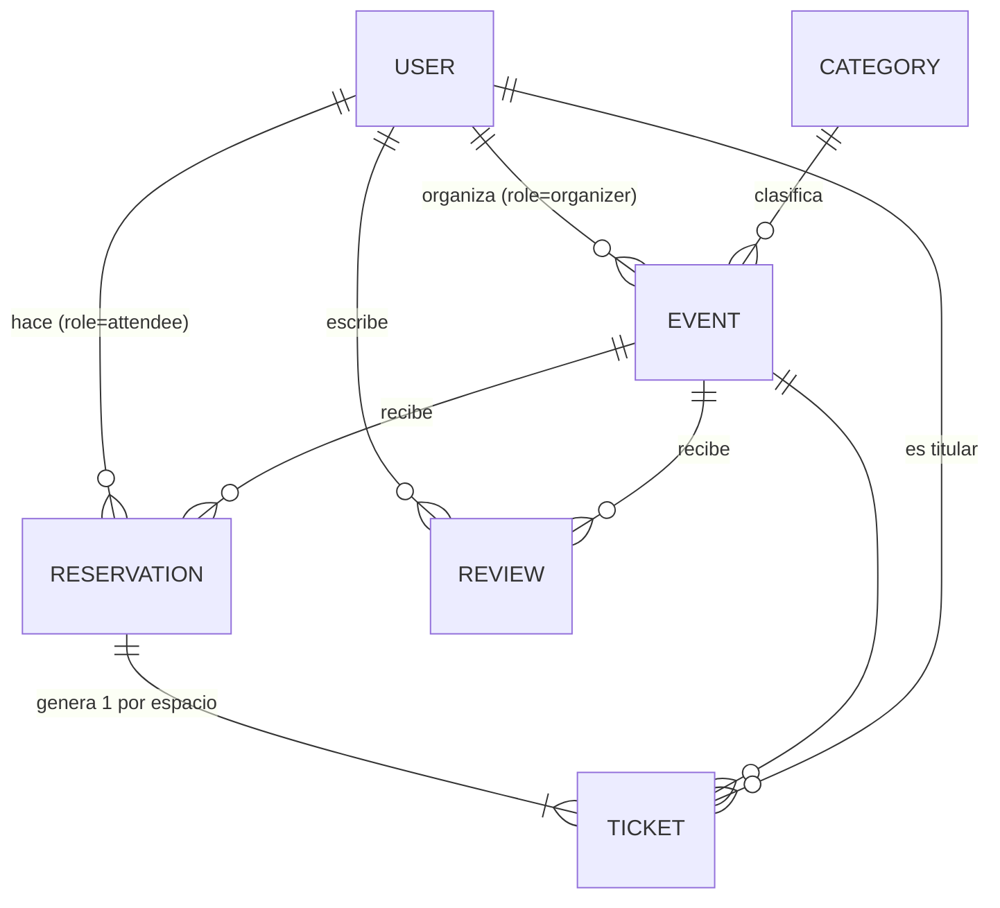

# EventHub · Base de datos y modelos (MongoDB + Mongoose)

> **Para:** Persona 2 (User y seguridad), Persona 3 (modelos de negocio), Persona 4 (lo que leen Lambda y el cron).
> **Mantiene:** Persona 1 (Frontend), como guía de lo que el frontend necesita. Última actualización: 20 de noviembre de 2026.

Esta guía describe las **colecciones, campos, relaciones, índices y reglas** que necesita EventHub para que el frontend funcione tal como está construido. Los nombres de campos coinciden con los que el frontend lee (ver [`frontend/app/types/models.ts`](../../frontend/app/types/models.ts)) y con el contrato de la API ([`docs/api/README.md`](../api/README.md)).

> Si el equipo decide cambiar un nombre o un tipo, **actualicen esta guía y avisen a la Persona 1** antes de programarlo.

---

## Índice

1. [Diagrama de relaciones](#1-diagrama-de-relaciones)
2. [Convenciones](#2-convenciones)
3. [Colecciones](#3-colecciones)
   - [users](#31-users) · [categories](#32-categories) · [events](#33-events) · [reservations](#34-reservations) · [tickets](#35-tickets) · [reviews](#36-reviews) · [seguridad](#37-colecciones-de-seguridad-persona-2) · [roles y permisos](#38-roles-y-permisos)
4. [Reglas de negocio que dependen de la base de datos](#4-reglas-de-negocio-que-dependen-de-la-base-de-datos)
5. [Consultas que el frontend necesita](#5-consultas-que-el-frontend-necesita)
6. [Datos de prueba (seed)](#6-datos-de-prueba-seed)
7. [Decisiones pendientes](#7-decisiones-pendientes)

---

## 1. Diagrama de relaciones



Resumen:

- Un **organizador** (User) tiene muchos **eventos**.
- Un **evento** pertenece a una **categoría**.
- Un **asistente** hace **reservaciones**; cada reservación es para un evento y una cantidad de espacios.
- Cada reservación genera **una entrada (Ticket) por espacio**, cada una con su QR.
- Un asistente puede dejar **una reseña** por evento si tiene una reservación confirmada.

---

## 2. Convenciones

| Tema | Acuerdo |
|---|---|
| Nombres de colección | En inglés, plural y minúscula (`events`). Los modelos de Mongoose en singular (`Event`). |
| Campos | `camelCase` en inglés. |
| Fechas | Tipo `Date` (Mongo guarda en UTC). `timestamps: true` en todos los esquemas (`createdAt`, `updatedAt`). |
| Dinero | `Number` entero en colones. `0` = gratis. |
| Referencias | `Schema.Types.ObjectId` con `ref`. La API hace `populate` donde el contrato lo indica. |
| Estados | Strings con `enum` (ver cada modelo). |
| Borrado | Preferir **estados** (`cancelled`, `status: 'disabled'`, `hidden`) antes que borrar documentos, para no romper historiales ni estadísticas. |
| Datos sensibles | `passwordHash` y tokens con `select: false` y **nunca** en respuestas de la API. |

---

## 3. Colecciones

### 3.1 `users`

Perfil **completo** del usuario. Además de identificarlo, son los datos que la **pasarela de pagos** necesita para precargar la compra (nombre, identificación, correo, teléfono y dirección).

> 🔒 **EventHub NUNCA guarda datos de tarjetas de crédito o débito** (número, vencimiento, CVV). Esos datos los escribe la persona directamente en la pasarela de pagos, que cumple PCI-DSS. La base de datos no debe tener ningún campo para eso.

| Campo | Tipo | Requerido | Notas |
|---|---|---|---|
| `_id` | ObjectId | ✓ | |
| `username` | String | ✓ | **Único** sin importar mayúsculas. 4–20 caracteres: letras, números, `.` y `_`. Se puede usar para iniciar sesión. |
| `firstName` | String | ✓ | Nombre(s). |
| `lastName1` | String | ✓ | Primer apellido. |
| `lastName2` | String | — | Segundo apellido (puede quedar vacío). |
| `name` | String | ✓ | Nombre **para mostrar**: `firstName + lastName1`, o el nombre de la organización si es organizador. Es el que se popula en eventos, entradas y reseñas. |
| `organizationName` | String \| null | — | Solo organizadores (por ejemplo "Sonido Vivo Producciones"). |
| `email` | String | ✓ | **Único**, en minúscula. También sirve para iniciar sesión. |
| `phone` | String | ✓* | 8 dígitos de Costa Rica, sin guiones (`88881234`). |
| `idType` | String enum | ✓* | `cedula` \| `dimex` \| `pasaporte`. |
| `idNumber` | String | ✓* | **Único**. Sin guiones ni espacios. Cédula: 9 dígitos · DIMEX: 11–12 dígitos · Pasaporte: 6–20 letras o números. |
| `birthDate` | String o Date | ✓* | `AAAA-MM-DD`. Mayor de 18 años. |
| `address` | Objeto | ✓* | `{ province, canton, line }`. `province`: una de las 7 provincias. `line` (dirección exacta) es opcional. |
| `passwordHash` | String | ✓ | bcrypt o Argon2. `select: false`. **Nunca** la contraseña en texto plano. Vacío solo si la cuenta es de Google. |
| `googleId` | String | — | Único y *sparse*, si inició sesión con Google. |
| `role` | String enum | ✓ | `admin` \| `attendee` \| `organizer`. Por defecto `attendee` (ver sección 3.8). |
| `status` | String enum | ✓ | `active` \| `disabled`. Por defecto `active`. |
| `emailVerified` | Boolean | ✓ | `false` al registrarse; `true` al verificar el correo (o si viene de Google). |
| `lastLoginAt` | Date \| null | — | Último ingreso exitoso. |
| `createdAt` / `updatedAt` | Date | ✓ | timestamps. |

\* Obligatorios para las cuentas que se registran desde el formulario. El administrador creado por el *seed* puede tenerlos vacíos hasta que complete su perfil.

**Índices:** `{ email: 1 }` único · `{ username: 1 }` único con *collation* que ignore mayúsculas · `{ idNumber: 1 }` único *sparse* · `{ googleId: 1 }` único *sparse* · `{ role: 1, status: 1 }`.

**Lo que ve el frontend** (respuesta de login y `/auth/me`): todos los campos **menos** `passwordHash` y `googleId`, más `permissions` (la lista de permisos de su rol). En otras respuestas solo `{ _id, name }`.

**Primer administrador:** se crea con el script de *seed* leyendo sus datos de **variables de entorno** (`SEED_ADMIN_USERNAME`, `SEED_ADMIN_EMAIL`, `SEED_ADMIN_PASSWORD`, …). Nunca escribir sus credenciales en el código ni subirlas a Git.

---

### 3.2 `categories`

| Campo | Tipo | Requerido | Notas |
|---|---|---|---|
| `_id` | ObjectId | ✓ | |
| `name` | String | ✓ | Visible, por ejemplo `Gastronomía`. Único. |
| `slug` | String | ✓ | **único**, minúscula, sin tildes ni espacios: `gastronomia`. Se usa en las URLs. |
| `order` | Number | — | Opcional, para ordenar en la interfaz. |

**Índices:** `{ slug: 1 }` único · `{ name: 1 }` único.

**Categorías que usa el frontend hoy** (los slugs tienen colores asignados en el frontend; si agregan otra, se ve con un color neutro):

`conciertos` · `comedia` · `teatro` · `gastronomia` · `tecnologia` · `talleres` · `deportes` · `ferias` · `arte` · `familia` · `bienestar` · `cine`

---

### 3.3 `events`

| Campo | Tipo | Requerido | Notas |
|---|---|---|---|
| `_id` | ObjectId | ✓ | |
| `name` | String | ✓ | 3–120 caracteres. |
| `description` | String | ✓ | Texto plano; párrafos separados con `\n`. Mín. 40 caracteres para publicar. |
| `category` | ObjectId → `Category` | ✓ | |
| `imageUrl` | String \| null | — | URL de S3 (Persona 4). `null` = sin imagen. |
| `location` | String | ✓ | Formato **"Lugar, Ciudad"**, por ejemplo `Centro de Eventos Pedregal, Belén`. El filtro "Lugar" compara el texto **exacto**, así que conviene que el mismo lugar se escriba siempre igual. |
| `date` | Date | ✓ | Fecha y hora de inicio (UTC). |
| `capacity` | Number | ✓ | Entero ≥ 1. |
| `availableSpots` | Number | ✓ | Entero entre 0 y `capacity`. Al crear = `capacity`. **Solo se modifica con `$inc` atómico** (ver regla 4.1). |
| `price` | Number | ✓ | Entero ≥ 0, en colones. `0` = gratis. |
| `status` | String enum | ✓ | `draft` \| `published` \| `cancelled` \| `finished`. Por defecto `draft`. |
| `organizer` | ObjectId → `User` | ✓ | Usuario con `role: organizer` (o el admin). |
| `summary` | String | publicar | Una frase, máx. 160 caracteres. |
| `imageAlt` | String | si hay imagen | Texto alternativo para lectores de pantalla. |
| `venueName` | String | publicar | Nombre del lugar. |
| `address` | String | — | Señas. |
| `city` | String | publicar | Ciudad o cantón. `location` se arma como `"venueName, city"`. |
| `province` | String enum | publicar | San José, Alajuela, Cartago, Heredia, Guanacaste, Puntarenas, Limón. |
| `endDate` | Date \| null | — | Fin del evento; después de `date`. |
| `doorsOpenMinutes` | Number | — | 0–240. Por defecto 30. |
| `maxPerPurchase` | Number | — | 1–10. Por defecto 10. |
| `minAge` | Number | — | `0`, `12`, `15` o `18`. Por defecto 0 (todo público). |
| `accessibility` | [String] | — | `wheelchair`, `parking`, `public_transport`, `sign_language`. |
| `importantInfo` | String | — | Una indicación por línea. |
| `createdAt` / `updatedAt` | Date | ✓ | timestamps. |

**Campos calculados que la API agrega a la respuesta** (no se guardan, o se guardan como caché):

| Campo | Cómo |
|---|---|
| `ratingAvg` | Promedio de `reviews.rating` con `hidden: false`, 1 decimal; `null` si no hay. |
| `ratingCount` | Cantidad de esas reseñas. |

> Si prefieren no calcularlos en cada consulta, pueden guardarlos en el evento (`ratingAvg`, `ratingCount`) y actualizarlos cada vez que se crea, edita u oculta una reseña.

**Índices:**

- `{ status: 1, date: 1 }`: catálogo público (publicados y futuros, por fecha).
- `{ category: 1, status: 1, date: 1 }`: filtro por categoría.
- `{ organizer: 1, date: -1 }`: panel del organizador.
- `{ organizer: 1, status: 1, updatedAt: -1 }`: lista "Mis eventos" con pestañas por estado.
- `{ location: 1 }`: filtro y agregación por lugar.
- Para la búsqueda `q`: índice de texto en `name` y `location`, **o** MongoDB Atlas Search (necesario para el "¿Quisiste decir…?" con fuzzy). La búsqueda debe **ignorar tildes**.

**¿Quién pasa un evento a `finished`?** El cron diario (Persona 4) o el propio backend: los eventos `published` con fecha pasada se tratan como finalizados. Decidir uno de los dos.

---

### 3.4 `reservations`

| Campo | Tipo | Requerido | Notas |
|---|---|---|---|
| `_id` | ObjectId | ✓ | |
| `event` | ObjectId → `Event` | ✓ | |
| `user` | ObjectId → `User` | ✓ | El asistente que reservó. |
| `quantity` | Number | ✓ | Entero de 1 a `event.maxPerPurchase` (máx. 10). |
| `unitPrice` | Number | ✓ | Precio por entrada **al momento de comprar** (colones). Si el organizador cambia el precio después, las compras viejas no cambian. |
| `total` | Number | ✓ | `unitPrice × quantity`. |
| `status` | String enum | ✓ | `pending` (esperando pago, guarda los espacios) \| `confirmed` \| `cancelled`. |
| `paymentStatus` | String enum | ✓ | `pending` \| `paid` \| `free` (evento gratis). |
| `paymentRef` | String \| null | — | Referencia que devuelve la pasarela. **Nunca** número de tarjeta, vencimiento ni CVV. |
| `paidAt` | Date \| null | — | Cuándo se confirmó el pago. |
| `expiresAt` | Date \| null | — | Solo con `status: pending`: `createdAt + 3 h`. Pasada esa hora, se cancela sola (regla 4.2). |
| `cancelledAt` | Date \| null | — | Cuándo se canceló. |
| `cancelledBy` | String enum \| null | — | `customer` \| `organizer` \| `system` (pago no confirmado en 3 h). |
| `ticketsSentAt` | Date \| null | — | Último envío de las entradas por correo. Sirve para limitar el reenvío a 1 por minuto. |
| `createdAt` / `updatedAt` | Date | ✓ | timestamps. `createdAt` se usa para "reservaciones por semana". |

**Índices:** `{ event: 1, status: 1, createdAt: -1 }` (lista del organizador, cupos y estadísticas) · `{ user: 1, status: 1, createdAt: -1 }` (Mis entradas y "Esperando pago") · `{ status: 1, expiresAt: 1 }` (tarea que cancela los pagos vencidos) · `{ createdAt: 1 }` (agrupación por semana).

> Las entradas (`tickets`) se crean **cuando el pago se confirma**, no antes. Una reservación `pending` no tiene entradas.

> ¿Se permite que un mismo usuario tenga **varias** reservaciones del mismo evento? Hoy los datos de prueba lo permiten. Si deciden que no, agregar el índice único `{ event: 1, user: 1, status: 1 }` con un filtro parcial `status: 'confirmed'`.

---

### 3.5 `tickets`

Una entrada por cada espacio reservado. Es lo que se muestra en "Mis entradas" y lo que se valida en la puerta.

| Campo | Tipo | Requerido | Notas |
|---|---|---|---|
| `_id` | ObjectId | ✓ | |
| `code` | String | ✓ | **Único**, legible, por ejemplo `EH-20372`. Se muestra en el boleto. |
| `reservation` | ObjectId → `Reservation` | ✓ | |
| `event` | ObjectId → `Event` | ✓ | Copiado de la reservación para consultar rápido. |
| `user` | ObjectId → `User` | ✓ | Titular (en la API se llama `holder`). |
| `status` | String enum | ✓ | `active` \| `used` \| `cancelled`. Por defecto `active`. |
| `usedAt` | Date \| null | — | Cuándo se validó en la puerta. |
| `qrValue` | String | ✓ | Texto que va **dentro** del QR. Debe ser un **token firmado** (JWT o HMAC) con al menos el `_id` de la entrada. **No** debe permitir adivinar otras entradas. |
| `createdAt` / `updatedAt` | Date | ✓ | timestamps. |

**Índices:** `{ code: 1 }` único · `{ user: 1 }` (Mis entradas) · `{ event: 1, status: 1 }` (validación y conteos) · `{ reservation: 1 }`.

**Estados visuales del frontend** (no se guardan):

| Estado en pantalla | Regla |
|---|---|
| Activa | `status: active` y faltan más de 3 días. |
| Pronto | `status: active` y faltan 3 días o menos. |
| Usada | `status: used`. |
| Vencida | `status: active` y el evento ya pasó. |
| Cancelada | `status: cancelled` **o** el evento está `cancelled`. |

---

### 3.6 `reviews`

Comentarios y calificaciones (RF-07).

| Campo | Tipo | Requerido | Notas |
|---|---|---|---|
| `_id` | ObjectId | ✓ | |
| `event` | ObjectId → `Event` | ✓ | |
| `user` | ObjectId → `User` | ✓ | |
| `rating` | Number | ✓ | Entero 1–5. |
| `comment` | String | — | Máximo 1000 caracteres. |
| `hidden` | Boolean | ✓ | Por defecto `false`. `true` = moderado por un admin (no se muestra ni cuenta en el promedio). |
| `createdAt` / `updatedAt` | Date | ✓ | timestamps. |

**Índices:** `{ event: 1, user: 1 }` **único** (una reseña por persona y evento) · `{ event: 1, hidden: 1, createdAt: -1 }`.

**Regla:** solo puede reseñar quien tenga una reservación `confirmed` de ese evento. Falta decidir si además el evento debe haber terminado.

---

### 3.7 Colecciones de seguridad (Persona 2)

No las muestra el frontend, pero son necesarias para RF-01, RF-02 y la sección 6 del enunciado (seguridad):

| Colección | Campos | Notas |
|---|---|---|
| `sessions` (o `refreshtokens`) | `user`, `tokenHash`, `ip`, `userAgent`, `expiresAt`, `revokedAt`, `createdAt` | Guardar el **hash** del token, nunca el token. Índice TTL en `expiresAt`. El logout llena `revokedAt`. |
| `accessLogs` | `user` (o `null` si no existe), `identifier` (usuario o correo que se intentó), `success`, `reason` (`ok` \| `invalid_credentials` \| `disabled` \| `rate_limited`), `ip`, `userAgent`, `createdAt` | Registro de **todos** los intentos de ingreso. Sirve para auditoría y para el límite de intentos: **5 fallidos en 15 minutos** por identificador → `429`. Índice `{ identifier: 1, createdAt: -1 }` y TTL opcional (por ejemplo 90 días). |
| `emailtokens` | `user`, `type` (`verify_email` \| `reset_password`), `tokenHash`, `expiresAt`, `usedAt` | Un solo uso y con expiración. Índice TTL en `expiresAt`. |

### 3.8 `roles` y permisos

Los permisos se definen **por rol**. El backend los revisa en **cada** endpoint con un middleware del tipo `authorize('events:create')`; el frontend solo los usa para mostrar u ocultar botones.

| Rol (`key`) | Nombre visible | ¿Se registra solo? | Para qué |
|---|---|---|---|
| `admin` | Administrador | No (se crea con el seed) | Dueño del sistema: **todos** los permisos. |
| `attendee` | Cliente | **Sí** (formulario "Crear cuenta") | Compra entradas, ve su historial, comenta. |
| `organizer` | Organizador | No: **solo el Admin lo asigna** | Publica y administra sus eventos. Oculto por ahora, pero existe porque el enunciado exige los tres roles (RF-03). |

Documento sugerido de la colección `roles`:

```json
{ "key": "attendee", "name": "Cliente", "selfRegistration": true, "assignableByAdmin": true,
  "permissions": ["profile:read:own", "profile:update:own", "reservations:create", "..."] }
```

Catálogo de permisos (`:own` = solo sobre lo propio):

| Permiso | Cliente | Organizador | Admin |
|---|:-:|:-:|:-:|
| `profile:read:own`, `profile:update:own` | ✓ | ✓ | ✓ |
| `reservations:create`, `reservations:read:own`, `reservations:cancel:own` | ✓ | ✓ | ✓ |
| `tickets:read:own` | ✓ | ✓ | ✓ |
| `reviews:create`, `reviews:update:own` | ✓ | ✓ | ✓ |
| `events:create`, `events:read:own`, `events:update:own` | | ✓ | ✓ |
| `files:upload` | | ✓ | ✓ |
| `reservations:read:own-events`, `tickets:validate:own-events`, `stats:read:own` | | ✓ | ✓ |
| `users:read`, `users:update` | | | ✓ |
| `categories:manage`, `events:manage` | | | ✓ |
| `reservations:read:all`, `reviews:moderate`, `stats:read:all` | | | ✓ |

> Si más adelante se necesita otro tipo de usuario, se agrega como un documento nuevo en `roles` con su lista de permisos, sin cambiar el código de los endpoints.

---

## 4. Reglas de negocio que dependen de la base de datos

### 4.1 Reservar sin sobreventa

```js
// 1) Descontar el cupo de forma atómica (solo si alcanza)
const event = await Event.findOneAndUpdate(
  { _id: eventId, status: 'published', date: { $gt: new Date() }, availableSpots: { $gte: quantity } },
  { $inc: { availableSpots: -quantity } },
  { new: true, session }
)
if (!event) throw conflict('NOT_ENOUGH_SPOTS') // o evento no disponible

// 2) Crear la reservación y una entrada por espacio, en la misma transacción
```

- Usar **transacción** (`session`) para que el descuento, la reservación y las entradas queden juntos o no quede ninguno. Las transacciones requieren MongoDB en *replica set*; Atlas ya lo trae.
- Debe existir una **prueba de concurrencia** con reservas simultáneas por el último espacio.

### 4.2 Cancelar una reservación

La puede cancelar **el cliente** (desde Mis entradas), **el organizador** del evento (desde Reservaciones) o **el sistema** si el pago no se confirmó en 3 horas.

- Solo si `status` es `pending` o `confirmed`, el evento **no ha ocurrido** y **ninguna** de sus entradas está `used`.
- `reservation.status → cancelled`, `cancelledAt = now`, `cancelledBy = customer | organizer | system`.
- Sus entradas `active` pasan a `cancelled`.
- Devolver el cupo con `$inc: { availableSpots: +quantity }`, sin pasarse de `capacity`. Hacerlo en la **misma transacción** que el cambio de estado, para no devolver dos veces si dos personas cancelan a la vez (filtrar por `status: { $ne: 'cancelled' }` en el `findOneAndUpdate`).
- Enviar correo de cancelación al cliente (Persona 4).

**Pago no confirmado (cancelación automática):** una tarea programada (EventBridge + Lambda, cada 5 minutos, Persona 4) busca `{ status: 'pending', expiresAt: { $lte: now } }` y aplica la misma cancelación con `cancelledBy: 'system'`. Si el webhook de pago llega **después** de eso, no se revive la reservación: se reembolsa.

**Los espacios cuentan como ocupados** mientras la reservación está `pending` o `confirmed`. Los ingresos solo suman las `confirmed`.

### 4.3 Cancelar un evento

- `event.status → cancelled`.
- Decidir: ¿se cancelan también las reservaciones y entradas, o el frontend las muestra como "Cancelada" solo por el estado del evento? El frontend ya soporta las dos opciones.
- Avisar por correo a los asistentes (Persona 4).

### 4.4 Validar una entrada en la puerta

- Verificar la firma de `qrValue` y buscar la entrada.
- Debe ser de un evento **del organizador** que valida.
- Si está `active`, pasarla a `used` con `usedAt`, en una operación atómica (`findOneAndUpdate` con `status: 'active'`) para que no se pueda usar dos veces al mismo tiempo.

---

## 5. Consultas que el frontend necesita

| Pantalla | Endpoint | Consulta |
|---|---|---|
| Inicio · Buscar | `GET /events` | `find({ status: 'published', date: { $gte: from, $lte: to }, ...filtros })` + `sort({ date: 1 })` + `skip/limit` + `countDocuments` + `populate('category organizer')` + rating. |
| Buscar · filtro Lugar | `GET /locations` | `aggregate([{ $match: publicados y futuros }, { $group: { _id: '$location', count: { $sum: 1 } } }, { $sort: { count: -1 } }])` |
| Detalle | `GET /events/:id` | `findById` + populate + rating. |
| Mis entradas | `GET /me/tickets` | `Ticket.find({ user })` + populate de `event` (con `category`) y `reservation`, ordenado por `event.date`. |
| Panel organizador | `GET /organizer/stats` | Agregaciones sobre `events` y `reservations` del organizador (ver contrato de la API, sección 2.7). |
| Mis eventos | `GET /organizer/events` | `find({ organizer })` + `$facet` para los conteos por estado (sección 2.11 de la API). |
| Reservaciones (organizador) | `GET /organizer/reservations` | `find({ event: { $in: idsDelOrganizador } })` + `populate('user', 'name email')` + `$facet` con conteos por estado y el resumen (vendidas, ingresos, ingresaron). Búsqueda por nombre, correo y código (sección 2.12). |
| Mis entradas · Esperando pago | `GET /me/reservations?status=pending` | `find({ user, status: 'pending' })` + populate del evento. |

---

## 6. Datos de prueba (seed)

El frontend tiene una base simulada **solo local** (no está en el repo) con esta forma. Les sirve de referencia para el script de seed del backend:

| Colección | Cantidad | Detalle |
|---|---|---|
| users | 158 | 1 admin (datos desde variables de entorno), 5 organizadores y 152 clientes con perfil completo ficticio (uno con entradas en todos los estados). |
| categories | 12 | Las de la sección 3.2. |
| events | 43 | Ficticios en lugares reales: Centro de Eventos Pedregal, Teatro Nacional, Parque Viva, Jazz Café, Antigua Aduana, Estadio Nacional… Incluye `draft`, `cancelled` y `finished`. |
| reservations / tickets | ≈ 7 800 / ≈ 19 000 | Con ocupaciones variadas: algunos eventos agotados y otros casi llenos. |
| reviews | 36 | Solo de eventos finalizados (12 por cada uno). |

Ejemplo de documento `events` tal como lo guardaría Mongo:

```json
{
  "_id": { "$oid": "6740a0a00000000000000001" },
  "name": "Festival de rock en Pedregal",
  "description": "Una noche de música en vivo...\nLas puertas abren 45 minutos antes...",
  "category": { "$oid": "6740a0010000000000000001" },
  "imageUrl": null,
  "location": "Centro de Eventos Pedregal, Belén",
  "date": { "$date": "2026-12-03T02:00:00.000Z" },
  "capacity": 3000,
  "availableSpots": 780,
  "price": 25000,
  "status": "published",
  "organizer": { "$oid": "6740a0020000000000000002" },
  "createdAt": { "$date": "2026-10-01T15:00:00.000Z" },
  "updatedAt": { "$date": "2026-11-20T18:00:00.000Z" }
}
```

---

## 7. Decisiones pendientes

| # | Tema | Afecta |
|---|---|---|
| 1 | ~~Reglas de cancelación~~ **Decidido:** cliente y organizador pueden cancelar mientras el evento no haya ocurrido y no se haya usado ninguna entrada; el sistema cancela las de pago no confirmado a las 3 h. **Falta:** política de reembolso (¿siempre?, ¿hasta cuántas horas antes?). | `reservations`, sección 2.12 de la API |
| 2 | ~~Al cancelar un evento, ¿se cancelan las reservaciones?~~ **Decidido:** sí, todas (`pending` y `confirmed`) con `cancelledBy: 'organizer'`, y sus entradas. | `events`, `reservations`, `tickets` |
| 3 | ¿Quién marca los eventos como `finished` (cron o backend)? | `events`, Persona 4 |
| 4 | ¿Un usuario puede tener varias reservaciones del mismo evento? | Índice de `reservations` |
| 5 | ¿Se puede reseñar antes de que termine el evento? | `reviews` |
| 6 | Máximo de entradas por compra (hoy 10) o por persona. | `reservations`, validación |
| 7 | Búsqueda: índice de texto o Atlas Search (para "¿Quisiste decir…?"). | `events` |
| 8 | Formato del `qrValue` (JWT u HMAC) y su secreto. | `tickets` |
| 9 | ~~¿El rol `organizer` se elige al registrarse?~~ **Decidido:** solo el Admin lo asigna. | `users`, `roles` |
