# EventHub · Frontend

Interfaz web de **EventHub**, la plataforma para buscar eventos, comprar entradas con código QR, organizar eventos y administrar el sistema.

Proyecto Final · Programación II · Persona 1 (Frontend, tareas F01–F09).

> El frontend **solo consume la API REST** del backend por HTTP: no se conecta a MongoDB ni a AWS directamente. Las reglas y la seguridad reales las aplica el backend. El contrato completo está en [`docs/api`](../docs/api/README.md) y el modelo de datos en [`docs/base-de-datos`](../docs/base-de-datos/README.md).

---

## Índice

1. [Tecnologías](#1-tecnologías)
2. [Instalación y ejecución](#2-instalación-y-ejecución)
3. [Variables de entorno](#3-variables-de-entorno)
4. [Scripts](#4-scripts)
5. [Arquitectura](#5-arquitectura)
6. [Diagrama de componentes](#6-diagrama-de-componentes)
7. [Estructura de carpetas](#7-estructura-de-carpetas)
8. [Páginas y acceso por tipo de cuenta](#8-páginas-y-acceso-por-tipo-de-cuenta)
9. [Flujos principales](#9-flujos-principales)
10. [Comunicación con la API](#10-comunicación-con-la-api)
11. [Integraciones externas](#11-integraciones-externas)
12. [Seguridad](#12-seguridad)
13. [Accesibilidad y diseño adaptable](#13-accesibilidad-y-diseño-adaptable)
14. [Pruebas automatizadas](#14-pruebas-automatizadas)
15. [Evidencias (capturas)](#15-evidencias-capturas)
16. [Compilación y despliegue](#16-compilación-y-despliegue)
17. [API de prueba local](#17-api-de-prueba-local)
18. [Conectar el backend real](#18-conectar-el-backend-real)
19. [Estado de las tareas](#19-estado-de-las-tareas)
20. [Uso de herramientas de IA](#20-uso-de-herramientas-de-ia)

---

## 1. Tecnologías

| Tecnología | Versión | Para qué |
|---|---|---|
| [Nuxt](https://nuxt.com) | 4.6 | Framework de Vue: rutas por archivos, renderizado en el servidor (SSR) y compilación. |
| Vue | 3.5 | Componentes con `<script setup lang="ts">`. |
| TypeScript | 6.0 | Tipos de todos los datos de la API (`app/types/models.ts`). |
| Pinia | 4.1 | Estado de la sesión del usuario. |
| Zod | 4.6 | Reglas de los formularios de cuenta. |
| Chart.js + vue-chartjs | 4.6 / 5.3 | Gráficos de ventas del panel. |
| qrcode | 1.5 | Dibuja el QR de cada entrada en el navegador. |
| jsQR | 1.4 | Lee códigos QR con la cámara cuando el navegador no tiene `BarcodeDetector`. |
| @nuxt/icon (Lucide) | 2.6 | Íconos, servidos desde el propio frontend. |
| @nuxt/fonts | 1.2 | Descarga las tipografías al compilar y las sirve desde el frontend. |
| Vitest + @nuxt/test-utils + happy-dom | 5.1 / 4.4 / 21 | Pruebas automatizadas. |
| vue-tsc | 3.3 | Revisión de tipos (`npm run typecheck`). |

## 2. Instalación y ejecución

**Requisitos:** Node.js 20 o superior y npm. El backend de EventHub corriendo (o la API de prueba local, sección 17).

```bash
cd frontend
npm install
cp .env.example .env        # en PowerShell: Copy-Item .env.example .env
npm run dev                 # http://localhost:3000
```

Antes de entregar o subir cambios:

```bash
npm run check               # tipos + pruebas + compilación (funciona en PowerShell, cmd y bash)
```

## 3. Variables de entorno

Se leen de `frontend/.env`. **El archivo `.env` no se sube a Git**; el repositorio solo tiene [`.env.example`](.env.example).

| Variable | Obligatoria | Para qué | Ejemplo (sin secretos) |
|---|:-:|---|---|
| `NUXT_PUBLIC_API_BASE` | ✓ | URL base de la API, sin barra al final. Es **pública** (la ve el navegador): no poner claves acá. | `http://localhost:4000/api/v1` |
| `SEED_ADMIN_USERNAME`, `SEED_ADMIN_PASSWORD`, `SEED_ADMIN_EMAIL`, `SEED_ADMIN_FIRST_NAME`, `SEED_ADMIN_LAST_NAME_1`, `SEED_ADMIN_LAST_NAME_2` | — | **Solo para la API de prueba local** (sección 17): datos de la cuenta Super Admin de prueba. El frontend no los usa. | — |

> El frontend no guarda ninguna clave secreta: las de Google, AWS, base de datos y pasarela de pago viven **solo en el backend**.

## 4. Scripts

| Comando | Qué hace |
|---|---|
| `npm run dev` | Servidor de desarrollo con recarga automática. |
| `npm run build` | Compila para producción en `.output/`. |
| `npm run preview` | Sirve la compilación de producción. |
| `npm test` | Corre todas las pruebas una vez (Vitest). |
| `npm run test:watch` | Pruebas en modo observación. |
| `npm run typecheck` | Revisa los tipos de TypeScript de todo el proyecto. |
| `npm run check` | Tipos + pruebas + compilación, en ese orden; se detiene en el primer error. |

## 5. Arquitectura

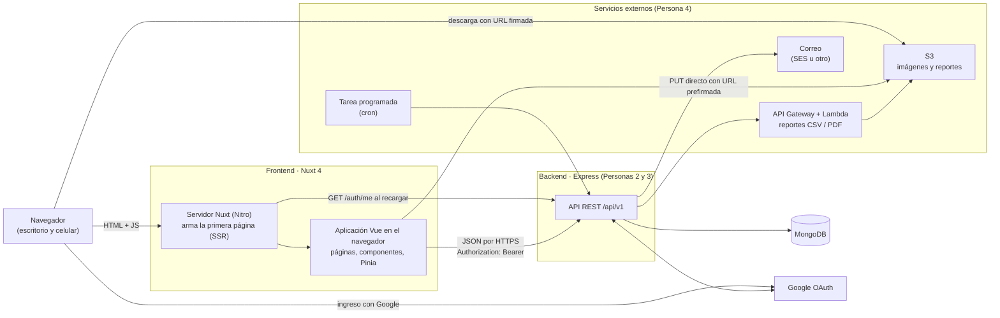

**Cómo funciona:**

- **Renderizado en el servidor (SSR):** la primera página llega armada desde el servidor de Nuxt, con el menú correcto según la sesión. Después la aplicación sigue en el navegador sin recargar.
- **Una sola puerta a la API:** todas las llamadas pasan por [`useApi`](app/composables/useApi.ts). Toma la URL de `NUXT_PUBLIC_API_BASE`, agrega `Authorization: Bearer <token>` si hay sesión y, si la API responde `401`, cierra la sesión.
- **Sesión:** [`plugins/session.ts`](app/plugins/session.ts) la recupera al abrir o recargar la página (cookie `eh_session` + `GET /auth/me`) y la guarda en Pinia ([`stores/session.ts`](app/stores/session.ts)). El contrato final con *refresh token* en cookie `HttpOnly` está definido en la [API, sección 2.23](../docs/api/README.md#223-sesión-token-de-acceso-y-renovación-refresh-token).
- **Protección de páginas:** [`middleware/auth.global.ts`](app/middleware/auth.global.ts) revisa el tipo de cuenta antes de abrir cada página (manda a Ingresar, a su panel o muestra 403). **Es solo navegación:** la seguridad real la aplica el backend en cada endpoint.
- **Dos diseños de página:** `default` (sitio público y Cliente) y `panel` (Organización y Super Admin, con barra lateral de íconos).
- **Archivos grandes sin pasar por el backend:** las imágenes se suben **directo a S3** con una URL prefirmada y los reportes se descargan **directo de S3** con una URL firmada que vence.

## 6. Diagrama de componentes

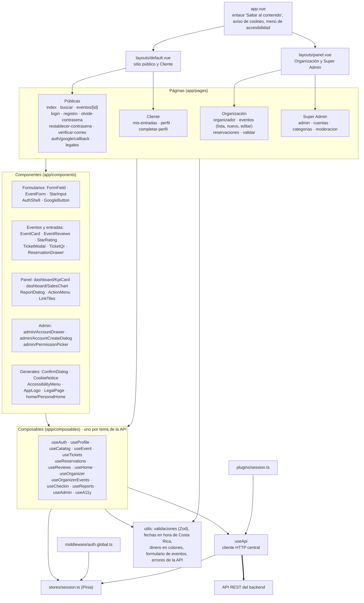

**Regla del proyecto:** las páginas **no** llaman a la API directamente. Llaman a un *composable* del tema (por ejemplo `useReservations`), que usa `useApi`. Así, si cambia una ruta del backend, se cambia en un solo lugar.

## 7. Estructura de carpetas

```
frontend/
├─ app/
│  ├─ app.vue            Raíz: diseño de página, enlace para saltar al contenido, aviso de cookies, accesibilidad
│  ├─ app.config.ts      Textos y menús del sitio
│  ├─ assets/css/        Estilos globales: paleta, tipografías, temas claro/oscuro y alto contraste
│  ├─ layouts/           default (sitio público) y panel (Organización y Super Admin)
│  ├─ pages/             Una página por archivo = una ruta (25 páginas)
│  ├─ components/        Componentes reutilizables (admin/, dashboard/, home/)
│  ├─ composables/       Llamadas a la API por tema
│  ├─ stores/            Pinia: sesión del usuario
│  ├─ middleware/        auth.global.ts: quién puede abrir cada página
│  ├─ plugins/           Recupera la sesión al recargar
│  ├─ utils/             Validaciones, fechas, dinero, formulario de eventos, lector de QR
│  ├─ content/           Textos legales (privacidad, términos, cookies)
│  └─ types/             Tipos de los datos de la API
├─ test/
│  ├─ unit/              Reglas y utilidades
│  ├─ components/        Componentes compartidos
│  └─ flows/             Flujos completos por tipo de cuenta
├─ public/               Archivos estáticos
├─ nuxt.config.ts
├─ vitest.config.ts
└─ .env.example
```

## 8. Páginas y acceso por tipo de cuenta

| Página | Ruta | Sin cuenta | Cliente | Organización | Super Admin |
|---|---|:-:|:-:|:-:|:-:|
| Inicio (novedades personales si es Cliente) | `/` | ✓ | ✓ | → Resumen | ✓ |
| Buscar (filtros, orden y páginas) | `/buscar` | ✓ | ✓ | ✓ | ✓ |
| Detalle del evento, reseñas y compra | `/eventos/:id` | ✓ (para comprar pide ingresar) | ✓ compra | ✓ (no compra) | ✓ |
| Ingresar / Crear cuenta (también con Google) | `/login`, `/registro` | ✓ | — | — | — |
| Vuelta del ingreso con Google | `/auth/google/callback` | ✓ | ✓ | ✓ | ✓ |
| Completar perfil (cuentas de Google) | `/completar-perfil` | → Ingresar | ✓ | ✓ | ✓ |
| Olvidé / restablecer contraseña, verificar correo | `/olvide-contrasena`, `/restablecer-contrasena`, `/verificar-correo` | ✓ | ✓ | ✓ | ✓ |
| Mis entradas (QR, historial, cancelar, reenviar) | `/mis-entradas` | → Ingresar | ✓ | → Resumen | ✓ |
| Perfil | `/perfil` | → Ingresar | ✓ | ✓ | ✓ |
| Resumen, Mis eventos, Crear/editar evento | `/organizador`, `/organizador/eventos/**` | → Ingresar | 403 | ✓ | ✓ |
| Reservaciones, Validar entradas | `/organizador/reservaciones`, `/organizador/validar` | → Ingresar | 403 | ✓ | ✓ |
| Resumen general, Cuentas y permisos, Categorías, Moderación | `/admin/**` | → Ingresar | 403 | 403 | ✓ |
| Privacidad, Términos, Cookies | `/privacidad`, `/terminos`, `/cookies` | ✓ | ✓ | ✓ | ✓ |

- La Organización y el Super Admin trabajan con la barra de íconos del panel.
- Las cuentas creadas con Google pueden navegar, pero no comprar hasta completar el perfil: se muestra un aviso en todas las páginas y el detalle del evento pide **Completar mi perfil**.

### Revisión rápida por tipo de cuenta

- **Sin cuenta:** buscar, filtrar y ordenar; abrir un evento y leer reseñas; al comprar, ir a Ingresar y volver al mismo evento.
- **Cliente con Google:** entrar con Google; ver que pide completar el perfil antes de comprar; completarlo y comprar.
- **Cliente:** comprar por tipo de entrada; ver el QR en Mis entradas; reenviar las entradas; cancelar según la política del evento; calificar un evento al que asistió; editar el perfil y cambiar la contraseña.
- **Organización:** crear un evento en 5 pasos (borrador → publicar, con imagen, tipos de entrada y mapa); editar, duplicar y cancelar; ver reservaciones; validar entradas con la cámara o con el código; descargar reportes CSV/PDF.
- **Super Admin:** ver estadísticas generales; crear cuentas de Organización o Lugar con permisos; administrar categorías; ocultar reseñas con motivo; usar el panel de organizador sobre todos los eventos.

## 9. Flujos principales

### Comprar entradas

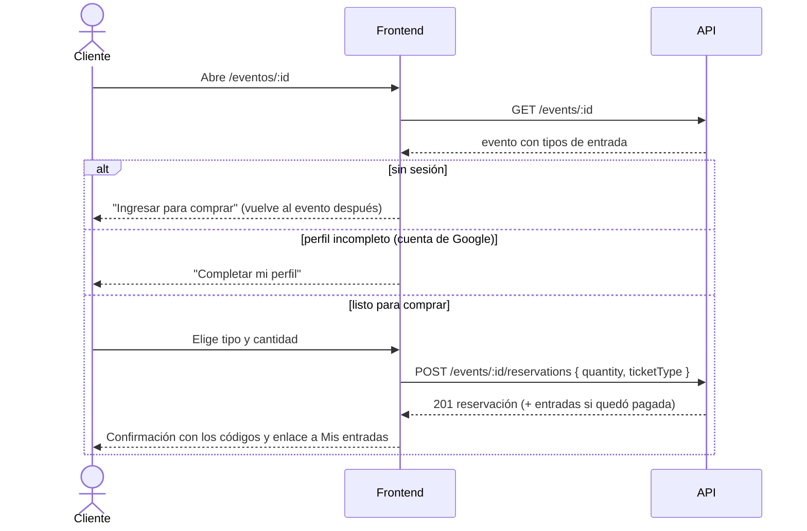

### Ingresar con Google

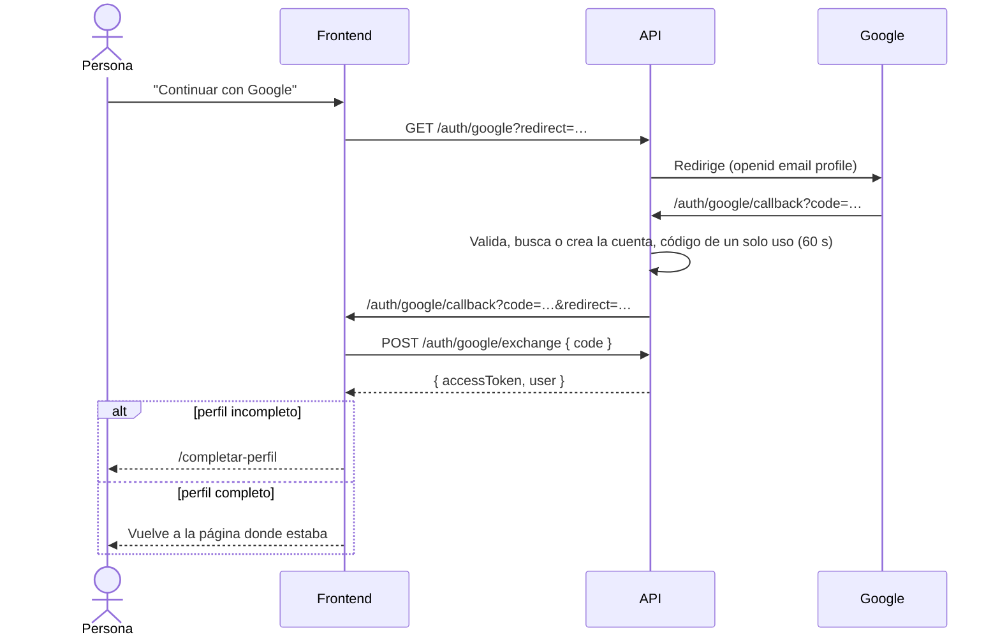

El token de sesión **nunca viaja en la URL**: solo un código que sirve una vez durante 60 segundos.

## 10. Comunicación con la API

- **Contrato:** [`docs/api/README.md`](../docs/api/README.md). Cada endpoint tiene su cuerpo, respuesta, errores y reglas. La [sección 0](../docs/api/README.md#0-para-empezar-guía-del-backend) es la guía de arranque del backend.
- **Tipos:** [`app/types/models.ts`](app/types/models.ts) tiene la forma exacta de cada respuesta.
- **Errores:** la API responde `{ code, message, details }`. El frontend muestra `message` tal cual y pone cada texto de `details` junto a su campo del formulario ([`utils/apiError.ts`](app/utils/apiError.ts)).
- **Fechas y dinero:** la API manda fechas en ISO UTC; el frontend las muestra en hora de Costa Rica. El dinero llega en colones enteros y se muestra como `₡25 000`.

| Composable | Endpoints principales |
|---|---|
| `useAuth` | `/auth/login`, `/auth/register`, `/auth/logout`, `/auth/google/exchange`, `/auth/forgot-password`, `/auth/reset-password`, `/auth/verify-email`, `/me/complete-profile` |
| `useProfile` | `PATCH /me`, `POST /me/password` |
| `useCatalog`, `useEvent`, `useHome` | `/categories`, `/events`, `/locations`, `/events/:id`, `/events/:id/reservations`, `/me/feed` |
| `useTickets`, `useReservations` | `/me/tickets`, `/me/reservations/*`, `/organizer/reservations/*` |
| `useReviews` | `/events/:id/reviews`, `/reviews/:id` |
| `useOrganizer`, `useOrganizerEvents` | `/organizer/stats`, `/organizer/events`, `/events` (crear, editar, publicar, cancelar, duplicar), `/files/upload-intent` |
| `useCheckin` | `/organizer/checkin/*`, `/tickets/validate`, `/tickets/:id/undo-validation` |
| `useReports` | `/reports` |
| `useAdmin` | `/admin/users`, `/admin/permissions`, `/admin/stats`, `/admin/categories`, `/admin/reviews` |

## 11. Integraciones externas

Lo que el frontend usa de servicios externos y cómo lo hace:

| Integración | Cómo la usa el frontend | Quién la configura |
|---|---|---|
| **Google OAuth 2.0** | El botón lleva al backend (`GET /auth/google`). Al volver, cambia un código de un solo uso por la sesión. Ningún dato ni clave de Google pasa por el frontend. | Persona 2 (credenciales en el backend) |
| **Amazon S3 · imágenes** | Pide una URL prefirmada (`POST /files/upload-intent`), sube la imagen con `PUT` **directo a S3** (JPG, PNG o WebP, máximo 5 MB) y guarda la dirección pública en el evento. | Persona 4 |
| **API Gateway + Lambda + S3 · reportes** | Pide el reporte (`POST /reports`), consulta cada 1,5 s hasta que esté listo y abre la URL firmada (vence en 15 minutos). | Persona 4 |
| **Correo (SES u otro)** | No lo usa directamente: los enlaces de los correos apuntan a `/verificar-correo`, `/restablecer-contrasena` y `/mis-entradas`. | Persona 4 |
| **Pasarela de pago** | Muestra el estado del pago (`pending` / `paid`) y el plazo de 3 horas. **Nunca** pide ni guarda datos de tarjeta. | Personas 3 y 4 (pendiente de definir) |
| **Google Maps (embed)** | Muestra el mapa del lugar con un `iframe` público (`google.com/maps?q=…&output=embed`), sin clave. | — |
| **Cámara del dispositivo** | Validar entradas: lee el QR con `BarcodeDetector` y, si el navegador no lo tiene, con jsQR. Pide permiso de cámara; también se puede escribir el código. | — |
| **Google Fonts** | `@nuxt/fonts` descarga las tipografías **al compilar** y las sirve desde el frontend (el navegador no se conecta a Google). | — |

## 12. Seguridad

- **Sin secretos en el frontend.** La única variable es la URL pública de la API.
- **Sin datos de tarjetas.** El pago lo hace la pasarela; EventHub solo guarda una referencia (`paymentRef`).
- **Sesión:** token en cookie `SameSite=Lax` (y `Secure` en producción), borrada al cerrar sesión o al recibir `401`. Se pasará a *refresh token* en cookie `HttpOnly` del backend según la [API, sección 2.23](../docs/api/README.md#223-sesión-token-de-acceso-y-renovación-refresh-token).
- **Redirecciones seguras:** después de ingresar solo se aceptan rutas internas ([`safeRedirect`](app/utils/session.ts)). Así nadie puede usar un enlace para mandar a otro sitio.
- **Datos personales mínimos en pantalla:** correos parcialmente ocultos en las listas (`a••••s@correo.cr`), identificación enmascarada en el perfil y, en las reseñas, solo nombre e inicial del apellido.
- **Google:** el token de sesión nunca va en la URL.
- **Roles:** el frontend oculta lo que no corresponde, pero **el backend debe revisar el permiso en cada endpoint** ([API, sección 1.3](../docs/api/README.md#13-quién-puede-usar-cada-parte-separación-de-accesos)).

## 13. Accesibilidad y diseño adaptable

- **Objetivo WCAG 2.1 AA.** Revisado con **axe-core** en 21 páginas, en escritorio (1366 px) y celular (390 px), con los 4 tipos de cuenta y en tema claro y oscuro. Además se revisaron las pantallas de Google y Completar perfil. Resultado: **0 problemas graves o moderados**.
- **Ninguna página se sale del ancho** de la pantalla en celular.
- **Formularios:** etiqueta en cada campo, errores leídos por lectores de pantalla (`aria-describedby`, `aria-live`), foco en el primer error y resumen de errores.
- **Teclado:** navegación completa con foco visible y enlace "Saltar al contenido".
- **Menú de accesibilidad** (botón flotante): tema claro, oscuro o automático, alto contraste, tamaño de letra y menos animaciones.
- **Botones** de al menos 44 px de alto en celular.

## 14. Pruebas automatizadas

```bash
npm test
```

**74 pruebas** con Vitest y `@nuxt/test-utils`, en un entorno de Nuxt con happy-dom. **No necesitan el backend:** las llamadas se responden con `registerEndpoint` sobre una URL de prueba (`/api-test`).

| Archivo | Qué prueba |
|---|---|
| `test/unit/authValidation.test.ts` | Reglas de ingresar, crear cuenta, perfil, cambio de contraseña y completar perfil: identificación de Costa Rica, teléfono, mayoría de edad, requisitos de la contraseña. |
| `test/unit/eventForm.test.ts` | Formulario de eventos: borradores, tipos de entrada, totales y qué falta para publicar. |
| `test/unit/dates-and-format.test.ts` | Fechas en hora de Costa Rica, rangos ("este fin de semana") y dinero en colones. |
| `test/unit/session-tickets-errors.test.ts` | Redirecciones seguras, inicio según el tipo de cuenta, estado de las entradas y lectura de errores de la API. |
| `test/components/components.test.ts` | Accesibilidad de `FormField`, `StarRating` y `PermissionPicker`. |
| `test/flows/access.test.ts` | Qué páginas puede abrir cada tipo de cuenta. |
| `test/flows/login-and-purchase.test.ts` | Ingresar (errores y éxito) y comprar por tipo de entrada (sin cuenta, tipo agotado, cantidad y total). |
| `test/flows/google-profile.test.ts` | Vuelta de Google (cancelado, código vencido, éxito), completar el perfil y bloqueo de la compra con el perfil incompleto. |

Durante el desarrollo, las pruebas encontraron y corrigieron un error real: no se podía guardar un borrador con solo el nombre del evento.

## 15. Evidencias (capturas)

Las capturas están en [`docs/capturas/frontend/`](../docs/capturas/frontend/) en escritorio (1366 px) y celular (390 px). Se tomaron con el sitio compilado, por tipo de cuenta, sin errores de JavaScript.

| Escritorio | Celular |
|---|---|
| 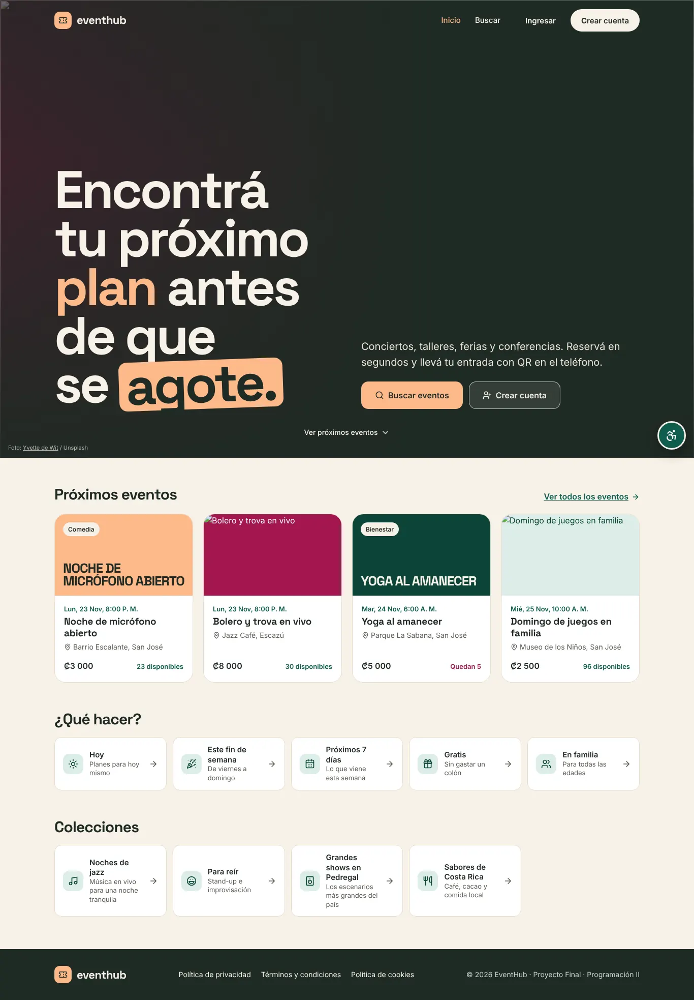 | 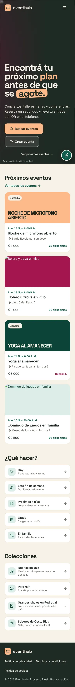 |
| 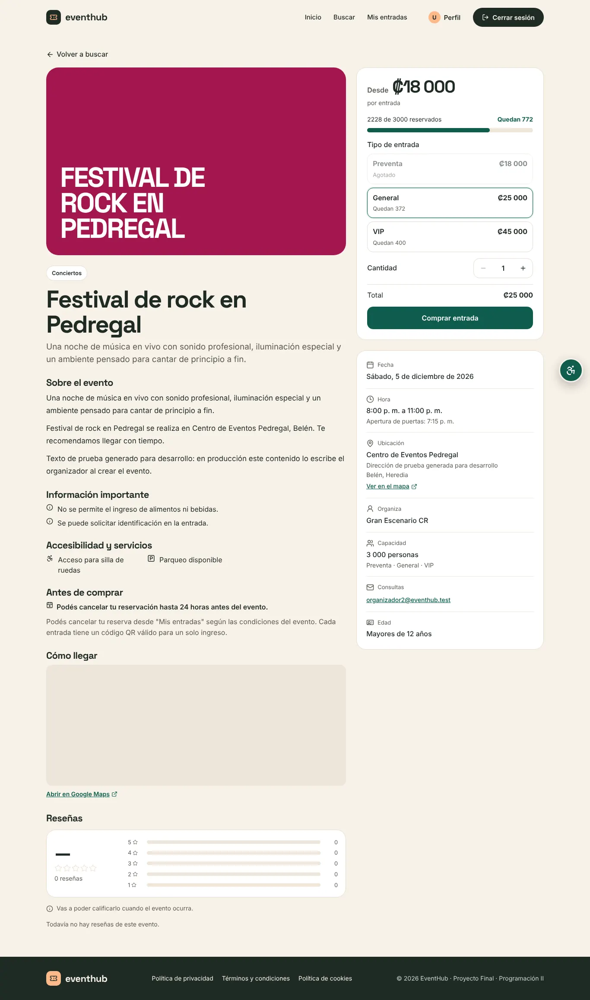 | 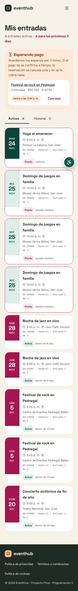 |
| 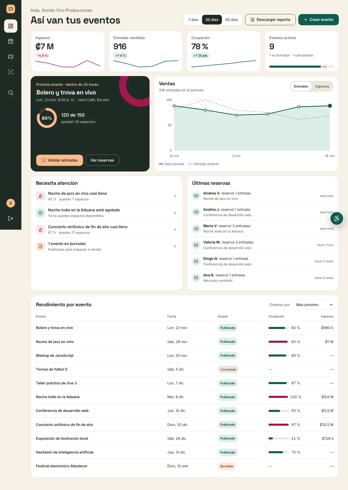 | 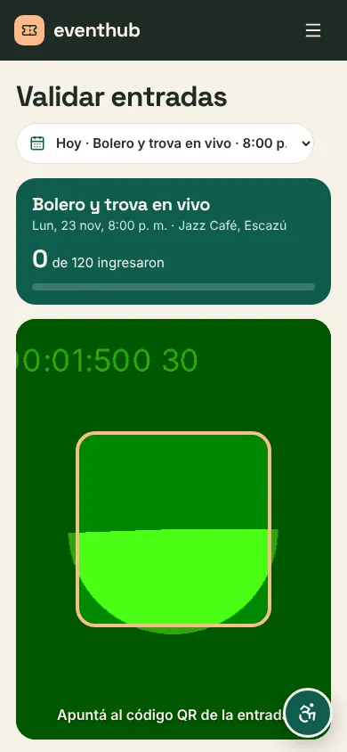 |
| 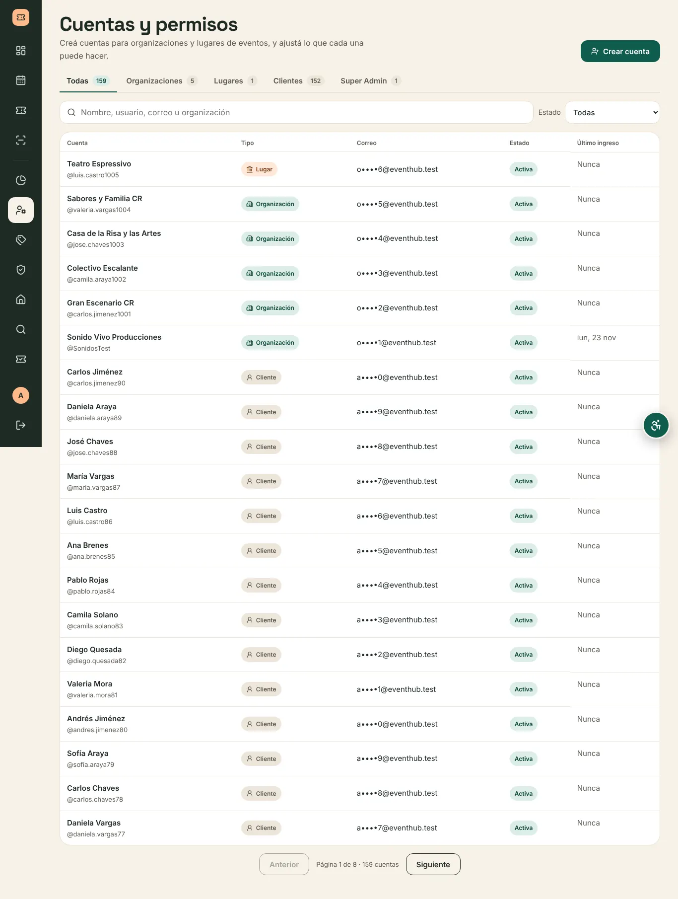 | 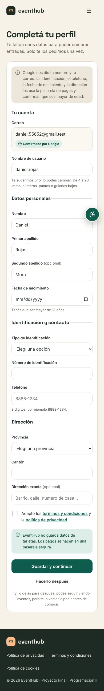 |

**Lista completa** (cada pantalla en `-escritorio.webp` y `-celular.webp`):

| Tipo de cuenta | Pantallas |
|---|---|
| Sin cuenta (`publico-`) | `inicio`, `buscar`, `detalle-evento`, `ingresar`, `crear-cuenta`, `olvide-contrasena` |
| Cliente (`cliente-`) | `inicio-personal`, `mis-entradas`, `perfil`, `detalle-compra` |
| Cliente con Google (`google-`) | `completar-perfil`, `evento-sin-perfil`, `ingreso-cancelado` |
| Organización (`organizacion-`) | `resumen`, `mis-eventos`, `crear-evento`, `reservaciones`, `validar-entradas` |
| Super Admin (`superadmin-`) | `resumen-general`, `cuentas`, `categorias`, `moderacion` |

Las capturas solo muestran datos ficticios de la API de prueba.

## 16. Compilación y despliegue

```bash
npm run build                                   # genera .output/
NUXT_PUBLIC_API_BASE=https://<api>/api/v1 node .output/server/index.mjs
```

- `.output/` es una aplicación de Node independiente: se puede desplegar en cualquier servicio que corra Node 20 (EC2, Elastic Beanstalk, Amplify con SSR, Render, Railway…). Persona 4 define dónde.
- `NUXT_PUBLIC_API_BASE` se puede cambiar **al arrancar**, sin volver a compilar.
- El backend debe permitir el origen del frontend en CORS (con `credentials` cuando exista el refresh token).
- Si el frontend y la API quedan en dominios distintos, revisar la [API, sección 2.23](../docs/api/README.md#223-sesión-token-de-acceso-y-renovación-refresh-token) (cookie de sesión).

## 17. API de prueba local

Para trabajar sin el backend hay una API simulada en `frontend/server/` y páginas de apoyo en `app/pages/dev/`:

- `/dev/correos`: los correos enviados, con sus enlaces;
- `/dev/google`: imita la pantalla de Google;
- `/dev/base-de-datos`: los datos de prueba.

**Esas carpetas están en `.gitignore` y no forman parte de la entrega.** Responden exactamente como dice el contrato de la API. Para usarla:

```bash
NUXT_PUBLIC_API_BASE=/mock-api npm run dev
```

Cuentas de prueba (solo en esa API local): Cliente `UserTest`, Organización `SonidosTest` y el Super Admin definido en `.env` (`SEED_ADMIN_USERNAME`). **Las contraseñas no se escriben en este documento.**

## 18. Conectar el backend real

1. En `.env`: `NUXT_PUBLIC_API_BASE=http://localhost:4000/api/v1` (o la URL del servidor).
2. El backend responde según [`docs/api/README.md`](../docs/api/README.md) y [`docs/base-de-datos/README.md`](../docs/base-de-datos/README.md).
3. Errores con el formato `{ code, message, details }`.
4. CORS permitido para la URL del frontend.
5. Recorrer la [revisión por tipo de cuenta](#revisión-rápida-por-tipo-de-cuenta) con una cuenta de cada tipo. Si una pantalla falla, comparar en la pestaña *Network* del navegador lo que devolvió la API con el contrato.

## 19. Estado de las tareas

| Tarea | Estado |
|---|---|
| F01 Estructura, rutas, diseños de página, estilos, variables de entorno | ✅ |
| F02 Registro, ingreso, Google, verificar correo, recuperar contraseña, completar perfil | ✅ |
| F03 Catálogo, detalle, búsqueda, filtros (categoría, fecha, lugar, precio), orden y páginas | ✅ |
| F04 Área de la organización: crear, editar, publicar, cancelar, imagen, reservaciones | ✅ |
| F05 Cliente: reservar, cancelar, historial, entrada con QR, comentar y calificar | ✅ |
| F06 Panel de la organización con estadísticas | ✅ (falta probarlo con datos de la API real) |
| F07 Panel del Super Admin: cuentas, permisos, categorías, moderación, estadísticas | ✅ · filtro por organización definido en la [API 2.24](../docs/api/README.md#224-filtro-por-organización-super-admin), pendiente en pantalla |
| F08 Cliente HTTP central, sesión, protección de páginas, errores | ✅ · renovación con refresh token definida en la [API 2.23](../docs/api/README.md#223-sesión-token-de-acceso-y-renovación-refresh-token), pendiente de conectar |
| F09 Pruebas, accesibilidad, diseño adaptable, compilación y documentación | ✅ |

**Para cerrar al 100%** falta la integración con los servicios reales:

- Personas 2 y 3: los endpoints reales;
- Persona 4: S3, reportes, correo y la URL de despliegue;
- Persona 2: las credenciales de Google.

## 20. Uso de herramientas de IA

Según la sección 11 del enunciado, se declara que en el frontend se usó **Claude (Anthropic)** como asistente durante el desarrollo:

- para proponer diseños de pantallas;
- para escribir y revisar código, pruebas y documentación;
- para revisar la accesibilidad y tomar las capturas.

Las decisiones de qué construir y cómo debía funcionar cada pantalla las tomó Persona 1, que revisó y probó el resultado y es responsable de explicar cualquier parte del frontend en la defensa.
